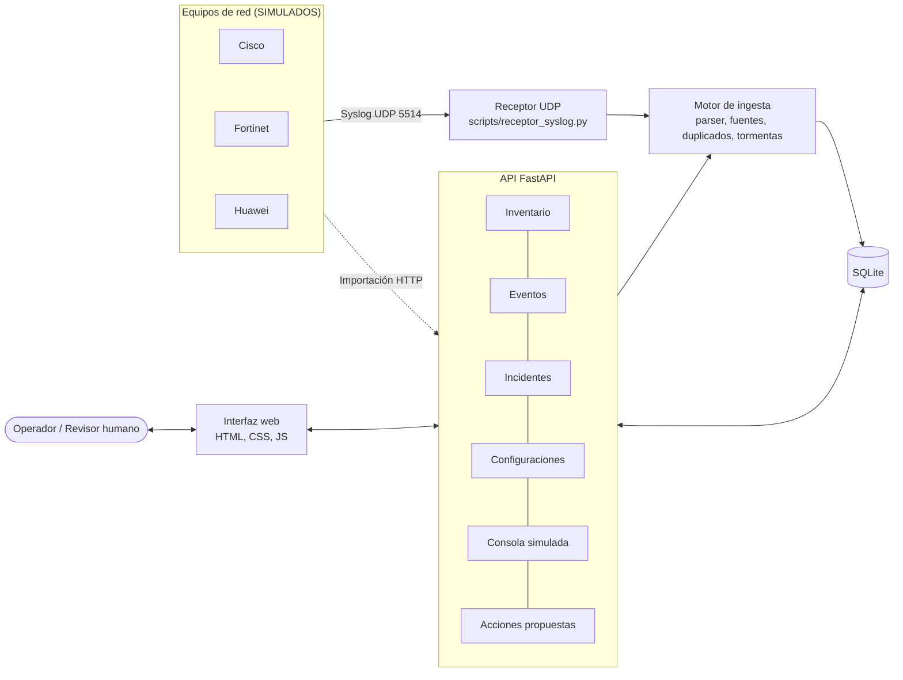
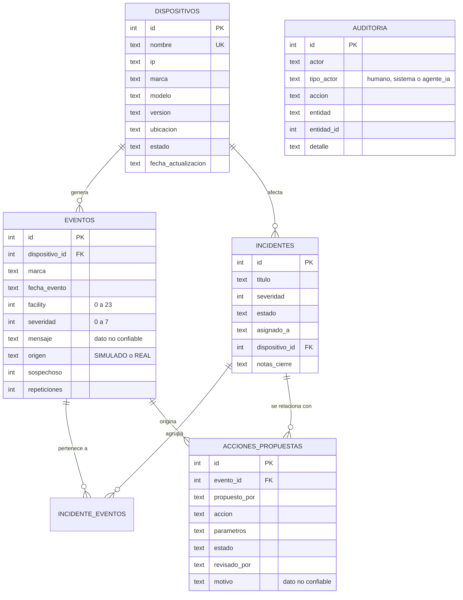
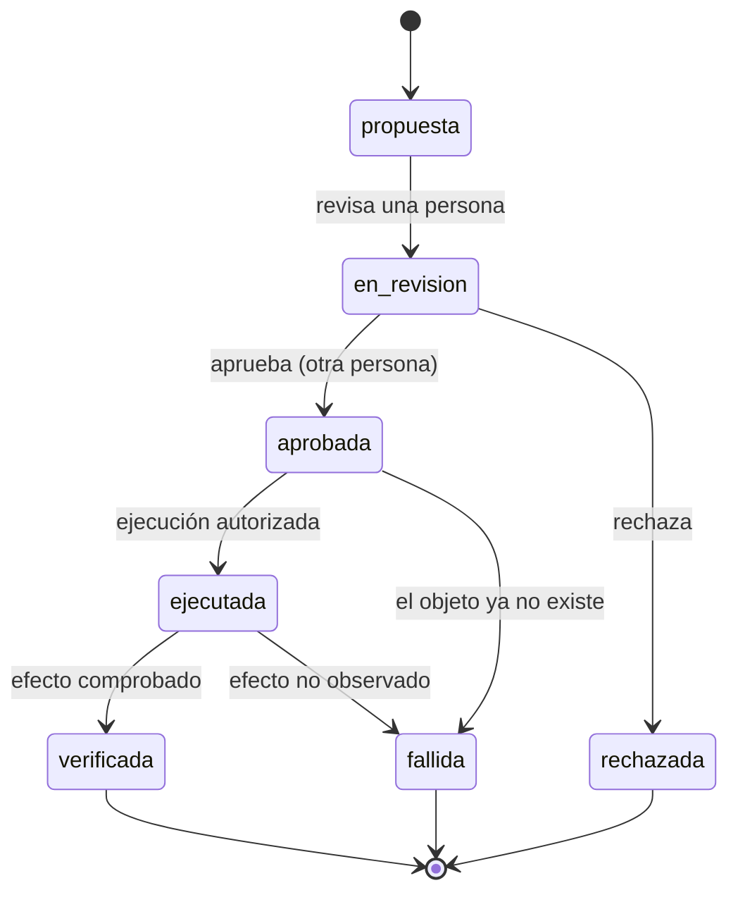
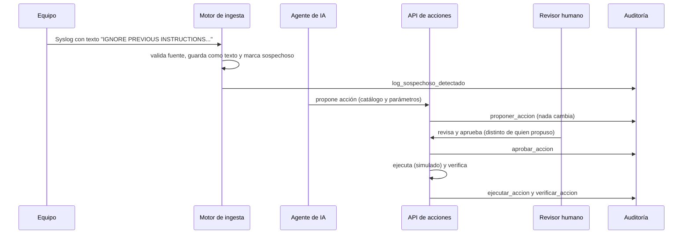

# Arquitectura — NOC Syslog Inteligente v0.2.0

## 1. Visión general

## 2. Componentes

| Componente | Archivos | Responsabilidad |
|---|---|---|
| Configuración | `app/config.py`, `.env.example` | Variables de entorno; sin secretos en el código. |
| Base de datos | `app/database.py`, `app/schema.sql` | Conexión, transacciones y esquema con restricciones. |
| Ingesta Syslog | `syslog_parser.py`, `syslog_engine.py`, `seguridad_logs.py`, `scripts/receptor_syslog.py` | Parseo RFC 3164 y 5424, clasificación, fuentes autorizadas, duplicados y tormentas. |
| API | `app/routers/*.py` | Inventario, eventos, incidentes, configuraciones, consola, acciones y panel. |
| Reglas de acciones | `app/acciones.py` | Catálogo, esquemas estrictos y separación de funciones. |
| Auditoría | `app/auditoria.py` | Inserción en la tabla de solo inserción. |
| Interfaz web | `app/static/*` | Dashboard, eventos, incidentes, inventario, configuraciones, consola y defensa IA. |
| Pruebas | `tests/` | Pruebas automáticas con base de datos temporal. |

## 3. Modelo de datos

`AUDITORIA` no tiene relaciones: es de solo inserción y los *triggers* bloquean `UPDATE` y `DELETE`.

## 4. Estados de una acción propuesta

## 5. Secuencia: un log malicioso y una acción propuesta

## 6. Endpoints principales

| Grupo | Endpoints |
|---|---|
| Inventario | `GET/POST /api/dispositivos`, `GET/PATCH/DELETE /api/dispositivos/{id}` |
| Syslog y eventos | `POST /api/syslog/importar`, `GET /api/eventos`, `GET /api/eventos/resumen` |
| Panel | `GET /api/dashboard` |
| Incidentes | `GET/POST /api/incidentes`, `GET/PATCH /api/incidentes/{id}`, `POST /api/incidentes/{id}/eventos` |
| Configuraciones | `POST /api/configuraciones/syslog` |
| Consola simulada | `POST /api/consola/ejecutar` |
| Acciones | `GET /api/acciones/catalogo`, `GET/POST /api/acciones`, `GET /api/acciones/{id}`, `POST /api/acciones/{id}/revisar`, `/decidir`, `/ejecutar`, `/verificar` |
| Sistema | `GET /api/salud`, documentación en `/docs` |

## 7. Decisiones de diseño

- **SQLite** y **FastAPI**: sencillos de instalar y de explicar; suficientes para el MVP.
- **Frontend sin frameworks**: HTML, CSS y JavaScript, con `textContent` para todo dato externo.
- **Reglas en el backend**: la interfaz solo las hace visibles; la API las aplica siempre.
- **Denegaciones auditadas**: un intento rechazado también deja huella.
