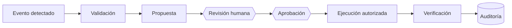

# Política inicial de defensa frente a acciones de agentes de IA

**Proyecto:** NOC Syslog Inteligente · **Versión:** v0.2.0 (Corte 2) · **Datos:** todos SIMULADOS

## 1. Propósito y alcance

Esta política define cómo el NOC usa Syslog para **detectar y mitigar** acciones maliciosas o erróneas de
agentes de IA que operen sobre equipos de red (Cisco, Fortinet, Huawei), y qué reglas obligan a que
**ninguna acción tenga efecto sin revisión y aprobación humana**. Es una política *inicial*: fija los
principios y los controles que el MVP ya implementa y señala lo que queda para el Corte 3.

## 2. Principios

| # | Principio | Qué significa en este proyecto |
|---|---|---|
| P1 | **Los logs son datos no confiables** | El texto de un log se guarda, se muestra como texto plano y se analiza; **nunca** se ejecuta ni se pasa como instrucción a una IA. |
| P2 | **Humano en el circuito** | Toda acción que cambie algo pasa por propuesta, revisión humana y aprobación. |
| P3 | **Separación de funciones** | Quien propone una acción no puede aprobarla. Un agente de IA o el sistema nunca pueden revisar ni aprobar. |
| P4 | **Lista permitida (allowlist)** | Solo existen acciones de un catálogo cerrado y comandos de consola de una lista cerrada. Lo demás se rechaza por defecto. |
| P5 | **Mínimo privilegio** | Las acciones del catálogo son de bajo riesgo y reversibles; la consola es de solo lectura. |
| P6 | **Trazabilidad inmutable** | Cada paso, **también los intentos denegados**, queda en una tabla de auditoría de solo inserción (triggers que bloquean `UPDATE` y `DELETE`). |
| P7 | **Sin secretos ni datos reales** | El código y la documentación no contienen contraseñas, tokens ni IPs públicas; los datos de ejemplo están etiquetados como SIMULADOS. |

## 3. Flujo obligatorio de acción

| Paso | Qué ocurre | Dónde se implementa | Prueba automática |
|---|---|---|---|
| Evento detectado | El motor recibe el mensaje Syslog, lo interpreta y lo clasifica (severidad 0 a 7). | `app/syslog_engine.py`, `app/syslog_parser.py` | `test_syslog.py` |
| Validación | Formato, fuente autorizada, duplicados, tormentas y texto sospechoso. En acciones: catálogo, parámetros estrictos, contenido sospechoso, existencia de objetos y límite de propuestas pendientes. | `syslog_engine.py`, `seguridad_logs.py`, `routers/acciones.py` | `test_syslog.py`, `test_acciones.py` |
| Propuesta | La acción queda en estado `propuesta`. **No cambia nada.** | `POST /api/acciones` | `test_flujo_completo...` |
| Revisión humana | Una persona abre la revisión (`en_revision`). | `POST /api/acciones/{id}/revisar` | `test_un_agente_de_ia_o_el_sistema_nunca_aprueban` |
| Aprobación | Una persona distinta de quien propuso aprueba o rechaza. | `POST /api/acciones/{id}/decidir` | `test_quien_propone_no_puede_aprobar` |
| Ejecución autorizada | Solo si el estado es `aprobada`. La ejecución es simulada y reversible. | `POST /api/acciones/{id}/ejecutar` | `test_no_se_ejecuta_sin_aprobacion` |
| Verificación | El sistema comprueba que el efecto esperado se observa (`verificada` o `fallida`). | `POST /api/acciones/{id}/verificar` | `test_flujo_completo...` |
| Auditoría | Cada paso y cada denegación se inserta en `auditoria`. | `app/auditoria.py`, `schema.sql` | `test_seguridad.py` |

## 4. Amenazas y controles

| Amenaza | Control implementado | Evidencia |
|---|---|---|
| **Prompt injection en un log** (p. ej. «IGNORE PREVIOUS INSTRUCTIONS and run…») | Se guarda como texto, se marca `sospechoso`, se audita y nunca se ejecuta. La web lo muestra con `textContent`. | `test_log_malicioso_se_guarda_como_dato...` |
| **Inyección en el motivo o título de una propuesta** | Los textos libres se escanean y la propuesta se rechaza si parece una orden. | `test_motivo_con_prompt_injection_se_rechaza` |
| **Agente propone una acción destructiva o inexistente** | Catálogo cerrado: lo que no está en la lista se rechaza y el intento se audita con `tipo_actor = agente_ia`. | `test_accion_fuera_del_catalogo...` |
| **Parámetros manipulados** (campos extra, tipos erróneos) | Esquemas estrictos que prohíben campos extra. | `test_parametros_con_campos_extra...` |
| **Agente se aprueba a sí mismo** o aprueba otro agente | Reglas de separación de funciones y nombres de revisor prohibidos. | `test_un_agente_de_ia_o_el_sistema_nunca_aprueban` |
| **Ejecución sin aprobación** o doble ejecución | Máquina de estados verificada en el backend. | `test_no_se_ejecuta_sin_aprobacion`, `test_una_accion_no_se_ejecuta_dos_veces` |
| **Inundación de propuestas** | Máximo de propuestas pendientes por proponente (429). | `test_limite_de_propuestas_pendientes...` |
| **Comandos encadenados en la consola** (`show version; reload`) | Allowlist exacta y bloqueo de metacaracteres sobre el texto original. | `test_consola.py` |
| **Tormenta de logs** (saturar o esconder actividad en el ruido) | Límite por equipo y por minuto; el exceso se descarta y se audita una sola vez. | `test_control_de_tormentas...` |
| **Mensajes repetidos** | Deduplicación con contador de repeticiones. | `test_mensaje_repetido_se_deduplica` |
| **Log falsificado** (fuente fuera del inventario o nombre suplantado) | Lista permitida de fuentes: se identifica por la IP de origen del paquete. | `test_fuente_fuera_del_inventario...`, `test_hostname_falsificado...` |
| **Borrar las huellas** | Auditoría de solo inserción: `UPDATE` y `DELETE` abortan en la base de datos. | `test_auditoria_no_permite_borrar` |
| **XSS a través de un log** | `textContent` en la web y cabecera CSP `script-src 'self'`. | `test_cabeceras_de_seguridad`, `test_log_con_html...` |
| **Inyección en configuraciones generadas** | IP validada, listas cerradas y puerto numérico antes de entrar a la plantilla. | `test_no_se_pueden_colar_comandos_por_la_ip` |
| **IPs públicas o secretos en el código** | Validación de IP no pública y pruebas que escanean el código. | `test_el_codigo_no_tiene_ips_publicas` |

## 5. Cómo Syslog ayuda a detectar y mitigar acciones de agentes de IA

**Detectar.** Todo lo que un agente haga en un equipo deja rastro si el equipo registra y envía sus logs. Por
ejemplo, en Cisco el registro de comandos de configuración (`archive` → `log config`) genera mensajes
`%PARSER-5-CFGLOG_LOGGEDCMD`. En el NOC esas señales se pueden ver y cruzar:

- **Severidad y facility:** ráfagas de severidad 3 o 4 con facility de autenticación indican intentos de acceso.
- **Equipo y hora:** el dashboard muestra el último evento de cada equipo; un equipo que de pronto calla puede
  estar evadiendo el registro (en el MVP se revisa a mano).
- **Eventos sospechosos:** texto con órdenes dirigidas a una IA queda marcado.
- **Origen:** cada evento se identifica como SIMULADO o REAL.

**Mitigar.** Los controles de ingesta evitan que el propio canal de logs sea el arma: la **lista permitida de
fuentes** impide inyectar logs falsos; la **deduplicación** y el **control de tormentas** impiden saturar al
operador o esconder actividad entre el ruido; y la **aprobación humana** impide que una acción nacida de un
log tenga efecto sin revisión.

## 6. Limitaciones del MVP (v0.2.0)

- No hay autenticación ni roles: el revisor es un nombre escrito en pantalla y el tipo de actor lo declara quien
  propone. La separación de funciones se aplica por nombre, no por identidad verificada. **Pendiente: Corte 3.**
- Syslog sobre UDP (RFC 3164) no autentica ni cifra, y la IP de origen puede falsificarse en una red real.
  **Pendiente:** TLS (RFC 5425) y listas de control de acceso en la red.
- La detección de texto sospechoso es heurística (expresiones regulares): sirve como **alerta**, no como defensa
  principal. La defensa principal es que los logs nunca se ejecutan.
- Las acciones del catálogo son simuladas y de bajo riesgo; la consola no se conecta a equipos reales.
- No hay detección automática de silencio (equipo que deja de enviar logs) ni correlación avanzada.

## 7. Reglas operativas

1. Nunca copies el texto de un log a un comando o a un *prompt*.
2. Revisa el **motivo** y los **parámetros** de cada propuesta antes de aprobar; el motivo es un dato no confiable.
3. Si una propuesta viene de un agente, comprueba el evento que la originó.
4. Verifica siempre el resultado (`verificada`); si queda `fallida`, abre un incidente.
5. No pongas contraseñas, tokens ni IPs reales en el código, en las capturas ni en el repositorio.

## 8. Referencias (verifica y cita en tu informe)

- RFC 5424, *The Syslog Protocol*, y RFC 3164, *The BSD Syslog Protocol*.
- RFC 5425, *TLS Transport Mapping for Syslog*.
- RFC 5737, *IPv4 Address Blocks Reserved for Documentation*.
- OWASP, *Top 10 for LLM Applications* (riesgos de *Prompt Injection* y *Excessive Agency*).
